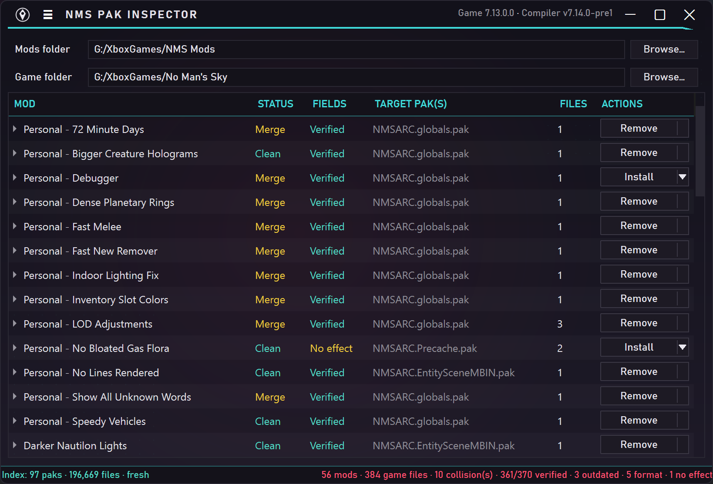
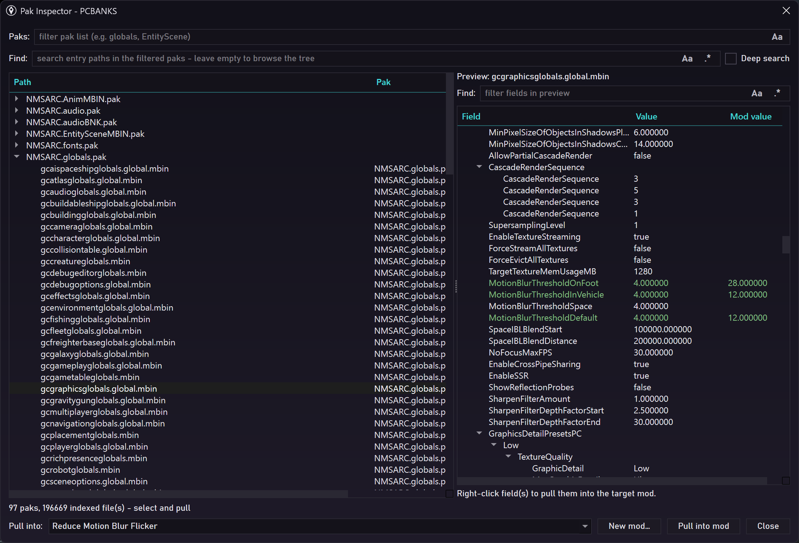

#   NMS Pak Inspector

Simple tool that can inspect, edit, and install No Man's Sky mods. This app is built mainly for personal use.

  
  

## Setup/Usage
1. Have Python 3.10 - 3.15 and the [.NET 8 Desktop Runtime (x64)](https://dotnet.microsoft.com/en-us/download/dotnet/8.0) (required by MBINCompiler).
2. Download/clone this repo.
3. Run `build_exe.bat` and wait until it's done.
4. Run `NMSPakInspector.exe`.
5. Optional: click `Check for compiler updates` in the menu (it downloads MBINCompiler when a newer release is available).
6. Point the app at your game folder and your mods folder; on first launch it builds a pak index (takes a moment).
7. Poke around and figure out the rest (start with `Inspect paks` in the ☰ menu).

## Features
- Lists mods from your mod folder; drag and drop archives (.zip/.7z/.rar) or folders onto the window to add them.
- Checks mod files against No Man's Sky's pak data without touching the game files; shows what's broken, outdated, ineffectual, etc.
- Pak inspector to browse/search paks, instant field-name deep search, DDS previews, pull files or fields into a mod.
- Per mod inline editor with side-by-side tree comparison; diff highlighting, preview, format auto-fix, raw-asset inspector.
- Ability to merge or resolve conflicts when multiple mods touch the same file.
- Inject mod data into the game's pak data, only changing what needs to be rewritten,
- or standard loose installation into `GAMEDATA\MODS` into a single managed folder.
- Automatic backup of modified pak files before injection, with restore option.
- Basic NexusMods support shows author, description, local and latest release, and mod page link. Nexus API key required, no premium needed.
- Automatically detects NMS version: clears injection state, rebuilds the index, and re-verifies everything.

## Notes
- NMS shows a "tampering" warning on launch when vanilla paks are modified via injection.
- Mods with outdated/error files can't be injected or installed until the mod is updated.
- This app is provided as-is, don't expect it to be user-friendly or bug-free; messing with pak files *can* brick your game. Use at your own risk.

## Credits & license

Pak format handling based on [HGPAKtool](https://github.com/monkeyman192/HGPAKtool).
MBIN compilation via [MBINCompiler](https://github.com/monkeyman192/MBINCompiler) by [monkeyman192](https://github.com/monkeyman192).

MIT License, Copyright (c) 2026 Kilvoctu — see [LICENSE](LICENSE).
